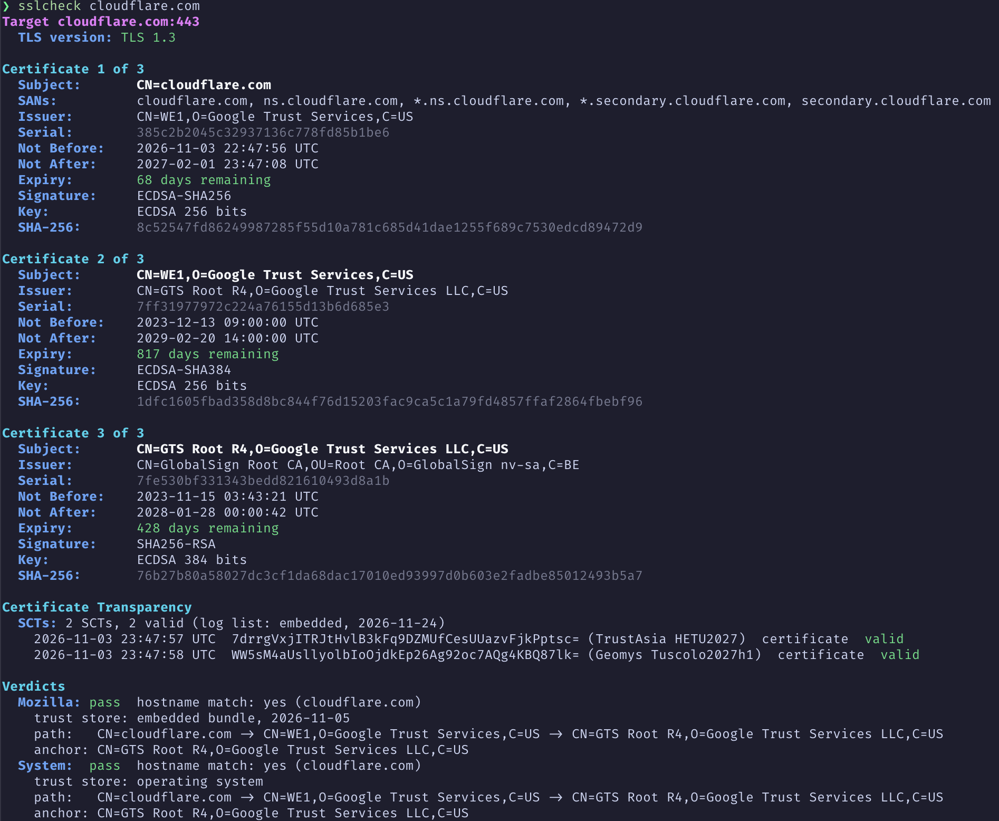

# sslcheck

A small command-line scanner that connects to TLS endpoints and reports on the
certificates they present. A scan always completes and reports, even when the
chain is expired, self-signed or untrusted. See [GLOSSARY.md](GLOSSARY.md) for
the terms used below.



## Install

```sh
brew install sollie/tap/sslcheck                 # macOS and Linux
docker run --rm ghcr.io/sollie/sslcheck example.com
go install github.com/sollie/sslcheck@latest
```

Release binaries are on the
[releases page](https://github.com/sollie/sslcheck/releases): Linux (amd64,
arm64, armv6), macOS (amd64, arm64) and Windows (amd64), with `checksums.txt`.
The Docker image is multi-arch (linux/amd64, linux/arm64, linux/arm/v6).

## Usage

```
sslcheck [flags] <host | host:port | https://host[:port]>...
```

The port defaults to 443. Several targets are scanned in parallel and reported
in the order given.

```sh
sslcheck example.com
sslcheck --strict -f json example.com:8443 https://example.org
sslcheck --starttls smtp mail.example.com:25
sslcheck --sni www.example.com 192.0.2.10
```

### Flags

| Flag | Description |
| --- | --- |
| `-f, --format` | Output format: `pretty` (default), `json`, `yaml` or `toml`. |
| `--pem` | Include each certificate as PEM. |
| `--no-color` | Disable colour output. |
| `--sni` | Server name to send, overriding the target host. |
| `--timeout` | Timeout for connect and handshake (default `5s`). |
| `-4, --ipv4` | Connect over IPv4 only. |
| `-6, --ipv6` | Connect over IPv6 only (not combinable with `-4`). |
| `--concurrency` | Maximum Scans run in parallel (default `8`, minimum `1`). |
| `--starttls` | `smtp`, `imap`, `pop3` or `none`. Default: inferred from the port. |
| `--trust-store` | PEM file of roots to verify against, replacing the Mozilla and system stores. |
| `--revocation` | Also query live OCSP (CRL when no OCSP URL) for every certificate except the root. This contacts URLs supplied by the certificates; see [Revocation](#revocation). |
| `--allow-private-revocation` | Let `--revocation` reach loopback, link-local and cloud-metadata addresses, for internal PKI. |
| `--strict` | Exit 2 when any trust store verdict fails. |
| `--update-trust-store` | Download the latest Mozilla bundle and CT log list into the cache directory and exit. |
| `--version` | Print version and exit. |

Boolean flags also accept `=true` / `=false`.

### Exit codes

| Code | Meaning |
| --- | --- |
| `0` | Every scan completed (verdicts may still fail unless `--strict`). |
| `1` | A target could not be scanned, or a usage/configuration error. |
| `2` | `--strict` and at least one verdict failed. An unavailable trust store does not count. |

If both apply, `2` wins.

### Output formats

`pretty` is human-readable: for each target the TLS version, the negotiated cipher suite, every certificate
in the presented chain (subject, SANs, issuer, serial, validity, days
remaining, signature, key, SHA-256, revocation), the Certificate Transparency
SCTs and one verdict per trust store with its path, anchor and findings.

`json`, `yaml` and `toml` carry the same data in a stable structure with a
top-level `schema_version` (currently `1`) and a `results` list, one entry per
target. Each result includes a `verdicts` list with one entry per trust store
(`store`, `store_info`, `pass`, `unavailable`, `reasons`, `path`, `anchor`,
`hostname_match` and `findings` with `severity` and `message`).

Each result also carries the negotiated `cipher_suite`. The scan handshake
offers every cipher suite Go implements, including those it disables by
default (RSA key exchange, 3DES), so legacy servers can be inspected; no other
connection the program makes does. A suite that is insecure or lacks forward
secrecy (RSA key exchange) adds a warning finding to each available verdict.

Colour is used only on a terminal. It is disabled by `--no-color` or
`NO_COLOR`, and forced by `CLICOLOR_FORCE` (any value but `0`).

### Verification

Each presented chain gets one verdict per trust store:

- **Mozilla**: the Mozilla bundle embedded in the binary, or a newer one
  fetched with `--update-trust-store`.
- **System**: the operating system's store.
- **Custom**: with `--trust-store`, only the given PEM file is used.

A verdict checks the chain, expiry, and that the hostname matches the SNI name.
Failures (expired, unknown authority, hostname mismatch, revoked) fail the
verdict; warnings (leaf expires within 30 days, unknown revocation status,
missing or invalid SCTs) do not. All problems found are reported, so an
expired self-signed certificate lists both `expired` and `unknown authority`.
A trust store with no roots is `unavailable`: never a pass, and it carries no
findings.

The `reasons` of a verdict are a stable set of values, safe to switch on:

| Reason | Meaning |
| --- | --- |
| `expired` | A certificate in the chain has passed its end of validity. |
| `not yet valid` | A certificate in the chain is not valid yet. |
| `unknown authority` | The chain does not lead to a root in the trust store. |
| `hostname mismatch` | The leaf does not match the checked name. |
| `revoked` | A certificate was reported revoked. |
| `verification failed` | Any other verification error; the detail is in the findings. |

Free-text detail appears only in `findings`. Expiry uses exact timestamps: a
certificate is warned about when 30 days or less remain, in both the
certificate block and the verdict.

### STARTTLS

`--starttls` upgrades a plaintext connection before the handshake. When not
given, the protocol is inferred from the port: 25 and 587 → `smtp`, 143 →
`imap`, 110 → `pop3`; everything else, including 465, 993 and 995, uses
implicit TLS. Use `--starttls none` to disable inference.

### Revocation

Stapled OCSP responses are always read. With `--revocation`, sslcheck also
queries OCSP (or the CRL when there is no OCSP URL) for every certificate
except the root. Each certificate is `good`, `revoked` or `unknown`; `revoked`
fails the verdict, `unknown` only warns.

`--revocation` contacts the OCSP and CRL URLs written in the certificates the
target presents, so the target chooses where sslcheck connects. Lookups follow
a fetch policy: only HTTP(S) URLs, at most 3 redirects (each to HTTP(S) only),
and responses over 1 MiB (OCSP) or 16 MiB (CRL) are rejected with a size error
rather than truncated. By default, connections to loopback, link-local and
cloud-metadata addresses are refused at connection time, so DNS names and
redirects cannot get around it. Pass `--allow-private-revocation` to lift this
for internal PKI. HTTPS responders are verified against the embedded Mozilla
roots when the system has no root certificates (for example in the container
image).

### Certificate Transparency

SCTs are taken from the certificate, the TLS extension and the stapled OCSP
response, and verified against a CT log list (embedded, or a newer cached one).
Missing or invalid SCTs raise a warning.

### Updating the trust store and CT log list

`sslcheck --update-trust-store` downloads the Mozilla bundle (curl's
`cacert.pem`) and the Chrome CT log list into the cache directory, then exits.
Without it, the data embedded in the binary is used.

> **Caveat:** the bundle download is checked against a SHA-256 fetched from the
> same server over HTTPS. This protects **integrity** (against corruption), not
> **authenticity**: a compromised or impersonated server can serve a matching
> bundle and checksum. Treat updated stores accordingly.

### Environment variables

| Variable | Description |
| --- | --- |
| `SSLCHECK_CACHE_DIR` | Replaces the OS user cache directory; data lives in `<dir>/sslcheck`. Point it at a writable volume in containers. |
| `SSLCHECK_TRUST_STORE` | PEM file used in place of the operating system store (the System verdict). |
| `SSLCHECK_BUNDLE_URL` | Mozilla bundle download URL; the checksum is fetched from the same URL plus `.sha256`. |
| `SSLCHECK_CT_LOG_LIST` | CT log list file replacing the embedded and cached lists. |
| `SSLCHECK_CT_LOG_LIST_URL` | CT log list download URL. |
| `NO_COLOR`, `CLICOLOR_FORCE` | Colour control, see above. |

### Docker

The image is built from `scratch` and runs as a non-root user, with
`SSLCHECK_CACHE_DIR=/cache` on a volume. To keep updates between runs:

```sh
docker run --rm -v sslcheck-cache:/cache ghcr.io/sollie/sslcheck --update-trust-store
docker run --rm -v sslcheck-cache:/cache ghcr.io/sollie/sslcheck example.com
```

The image has no system trust store, so the System verdict is reported as
unavailable there. Updates still work: when the system has no roots, the
downloader trusts the embedded Mozilla bundle.

## Not yet

- Cipher suite and protocol version enumeration.
- STARTTLS for protocols other than SMTP, IMAP and POP3 (for example FTP, LDAP,
  XMPP, PostgreSQL).

## Development

See [AGENTS.md](AGENTS.md) and [docs/](docs/). Releases are built with
goreleaser; see [docs/homebrew-tap.md](docs/homebrew-tap.md).

## License

[MIT](LICENSE)
